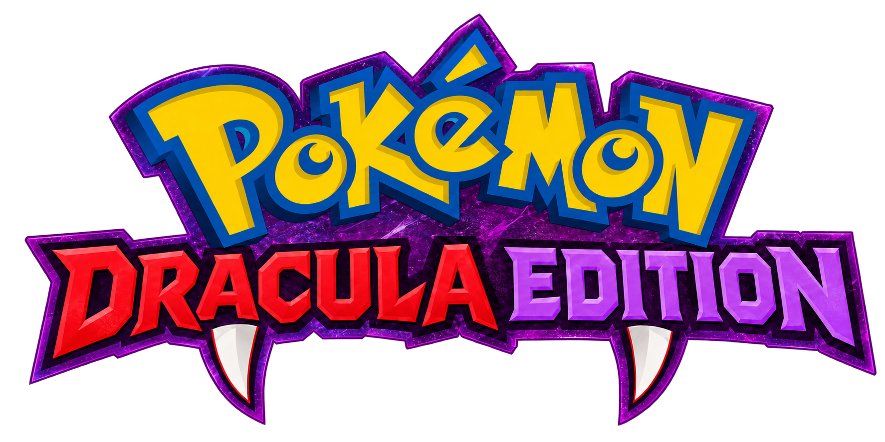

# Poke Dracula Edition



## The Project

Pokemon Dracula Edition is a vampire survivor like pokemon fangame, written in Vanilla JavaScript ES
modules, Canvas 2D and Web Audio -- no framework, no dependencies, no build step; to run on a web browser. 
Inspired by the fangame Pokemon Survivor Burst, but with exclusive features and ways of approaching vampire survivor. 
A personal project that leans towards learning about JavaScript and building a fun game.

## Credits

The Pokemon sprites and portraits in `assets/` come from the **[PMD Sprite Collab](https://sprites.pmdcollab.org)**,
a community project. Each sprite and portrait is the work of individual contributors, who are
credited per-Pokemon on the project's
**[Contributors page](https://sprites.pmdcollab.org/#/Contributors)**. Thank you to all of them.

Pokemon is a trademark of Nintendo, Game Freak and Creatures Inc. This is a non-commercial fan
project and is not affiliated with them.

Code, music, sound, UI and the fallback pixel art were made for this project.

Every piece of supplied art and audio is optional. The PMD sprite sheets, the ripped tilesets and
the soundtrack all have a drawn or synthesised fallback in `src/data/art.js` and `src/audio.js`,
so the game runs from a bare checkout and gets better as assets are added. See
[`assets/README.md`](assets/README.md).

## Running it

ES modules will not load over `file://`, so the folder has to be served over HTTP. Run **one** of these
from this directory, then open the address it prints:

```
python tools/serve.py       # -> http://localhost:8000   (recommended while developing)
npx serve .                 # -> http://localhost:3000
python -m http.server 8000  # -> http://localhost:8000
```

`tools/serve.py` is the plain Python server with caching turned off. With the other two, a browser
can keep running an old copy of a script after it has been edited -- even across a server restart
-- so a change that is plainly in the code does not show up. If that happens, reload with
`Ctrl+Shift+R`, or tick *Disable cache* in the DevTools Network tab.

### Testing the secret floors

Portals are rare (15% per floor), so there are shortcuts. Add these to the address:

| Option | Effect |
|---|---|
| `?debug=1` then `O` in a run | Opens a portal right beside you, now |
| `?portal` | On floors 1-3, a portal opens beside you 3 seconds after arriving |
| `?boss=<name>` | Every portal leads to that legendary (`articuno`, `moltres`, `zapdos`, `regirock`, `regice`, `registeel`, `entei`, `raikou`, `suicune`) |

For example `?debug=1&char=eevee&stage=cave&boss=registeel` skips the menus; press `O`, step
onto the portal and press `Enter`.

## Controls

| Key | Action |
|---|---|
| `WASD` / arrow keys | Move; navigate every menu |
| `Q` / `E` | First / second ability |
| `Backspace` / `P` | Pause; back out of any menu (`Esc` also works, but in fullscreen the browser uses it to leave fullscreen) |
| `1`-`3` / arrows + `Enter` | Choose on any card screen |
| `Enter` | Take the stairs (standing on them); dismiss the evolution cutscene |
| `1` / `2` (after the boss) | Take the win / keep going into endless |
| `1`-`3` (`4` with the perk) during play | Use that slot of the Explorer's Bag; standing on an item with a full bag, swap it in |
| `Enter` (at an awake Fortune totem) | Make an offering |
| `R` | Reroll on level-up, restart otherwise |
| `B` / `S` | Banish / skip a level-up (press `B` twice to confirm) |
| `Q` (paused / after a run) | Back to partner select |
| `O` (paused) | Settings — volume, key bindings, back to menu, restart |
| `M` | Mute |
| `F` | Fullscreen -- 640x360 is an exact 3x fit for 1080p |

The game opens on a **main menu** — PLAY, SUCCESSES, KECLEON SHOP, OPTIONS, CREDITS — driven with
the arrows (or W/S) and Enter. PLAY goes to partner select, where you pick one of six
partners, and then to stage select.
`?char=wooper|eevee|rowlet|vulpix|delibird|gastly|axew` skips straight into a run with that
partner (locked or not), and `?stage=grass|cave|beach` picks where.

**A secret seventh partner.** Pressing Right past Gastly turns the select screen to a second page
(six cards to a page; Left from its first card turns back, and digits 1-6 pick within the page).
Until it is earned, that page holds a locked card: a black silhouette with a padlock, no name or
numbers, and the hint "A WILD BEAST AWAITS...". Enter on it only buzzes. Claim the **Wild Beast**
success and it becomes **Axew** -- Dragon type, a bruiser (120 HP, slow, 2 armour, +15% power) with
**Mold Breaker** (hits ignore 4 armour and drive a quarter of their damage through Magnet Field
shields). It evolves into **Fraxure** at 10 (**Axe Kick**: critical hits knock foes back hard) and
**Haxorus** at 20 (**Rough Skin**: whatever touches you is cut). Shiny sprites cover all three.

## Settings

`O` opens settings from the title screen or from the pause screen: separate music and sound
volume sliders, and a **controls page where every key can be rebound** — movement, both
abilities, pause, restart, mute, fullscreen, and the level-up reroll / banish / skip. Binding a
key another action already holds swaps the two rather than leaving anything unbound.

The arrow keys, `Enter` and `Escape` are fixed aliases and always work, so a binding you regret
can always be undone. Volumes and bindings are saved to `localStorage`, and a browser that blocks
storage simply starts from the defaults.

Two separate keys are written: `pokesurvivor.settings.v1` for preferences and
`pokesurvivor.save.v1` for the gold bank and shop ranks. They are kept apart deliberately --
losing your settings is an annoyance, losing your progress is not, and a corrupt blob in one must
not be able to take the other down with it.

## Debug tools

Append `?debug=1` to the URL for the developer overlay (frame timing, entity counts, hitboxes).
Other URL parameters: `?seed=`, `?t=` (start N seconds into a run), `?char=`, `?stage=`, `?level=`.
`?spriteedit=1` opens the in-page pixel editor used to author the sprites in `src/data/art.js`.

## Abilities

Each partner has two abilities, exclusive to it, drafted from the level-up screen. The first is
guaranteed to appear within three level-ups; the second unlocks when you evolve at level 10.

Evolving plays a cutscene that **holds on its last frame until you press Enter**, so you get to
read which form you landed on and what it changed before being dropped back into the crowd. The
new form lands with a shockwave that clears the area and a second and a half of invulnerability.

An ability at its **last level (5)** gets a new look: each one layers its own sprite effects
(sparks, light streaks, rings, embers, motes from the Gravity Circuit set) and shifting colours on
its cast — an iridescent Protect Bubble, ember spirals through Fire Spin, rainbow spray on Hydro
Pump, lightning on every Thunderbolt strike. What it does is unchanged.

**Sharpshoot (Rowlet's line).** Evolving into Dartrix unlocks a bar of bonus crit chance, shown
beside the ability slots. Every crit fills it: +1% per crit up to 50%, then +0.5% per crit, up to
+100%. It lasts the rest of the run, Decidueye included.

| Partner | `Q` | `E` (after evolving) |
|---|---|---|
| Wooper | **Protect Bubble** -- shield that blocks all contact damage, then bursts | **Earthquake** (Quagsire) -- shockwaves that stun; flying enemies are immune |
| Rowlet | **Homing Leaf** -- blades that seek separate targets and curve back | **Spectral Arrow** (Dartrix) -- pierces a line, executes the wounded, leaves a burning trail |
| Eevee | **Hyperbeam** -- massive damage, but you cannot move while firing | **Thunderbolt** (Jolteon) -- lightning falls from the sky into a marked circle and leaves it crackling |
| Eevee | | **Hydro Pump** (Vaporeon) -- a tsunami: a wall of water that rolls out along the aim, sweeping everything ahead of it and healing you |
| Eevee | | **Dark Pulse** (Umbreon) -- rings that leave a lasting pool of shadow |
| Gastly | **Shadow Ball** -- an orb thrown at a target that gnaws at everything it drifts past, then bursts | **Night Shade** (Haunter) -- opens a shadow that drains whatever stands in it |
| Vulpix | **Flamethrower** -- hurls a spinning fire star that bursts where it lands, leaving everything burning | **Fire Spin** (Ninetales) -- a vortex of flame that wraps around you and moves with you |
| Delibird | **Present** -- throws the gift on a short arc: four times in five it detonates, the fifth time it heals you | **Blizzard** (Hustle) -- hail falls across the whole screen; little damage, but nothing moves through it |
| Axew | **Crunch** (crunch_sound / crunch_sound2, at random) -- the Bite sheet's jaws open over the nearest foe and slam shut: everything in the bite (the jaws' own size) is hurt, and what survives is stunned for 1.6s and weakened | **Draco Meteor** (Fraxure) -- one meteor per level of the ability falls at random spots around you, one after another, each with its own small_explosion sound; each blasts the ground, burns what survives and leaves you 30% faster for 3s. Haxorus makes each one bigger and harder, never more of them |

Every ability has its own sound, named on the ability itself rather than derived from what it
does -- Dark Pulse, Night Shade and Lick are all built from the same ring effect and have to sound
nothing like each other. Fire Spin and Thunderbolt each pick between two files on every cast.

Both abilities level 1-5 through further level-up draws. The HUD shows each slot's icon, its key,
and a cooldown that drains as it recharges. Below 20% health a `!` appears over your Pokémon's
head, the way it does in Mystery Dungeon, and stays until you heal.

### Burn

Fire is the only thing in the game that keeps hurting after it has hit you. A burning enemy takes
damage four times a second for as long as it lasts, carries an animated flame over its head, and
**ignores armour** -- charging the armour toll on every instalment is an artefact of the tick rate
rather than a decision, and it would leave fire doing almost nothing to exactly the rock-types it
ought to melt. Burns refresh rather than stack: the strongest and the longest win.

Casting plays your form's **Attack animation** once, from its own PMD sheet, in whatever
direction you are facing. Decidueye and Gengar do not grant a third ability --
they make the second one enormous instead.

## Weapons and types

Every weapon has a **Pokemon type**, shown on its level-up card as the same colour-coded badge
the partner select uses, and you are only ever offered weapons matching one of your
current form's types. Eleven types, six weapons each, **four weapon slots** -- so a run picks four
out of six and no two partners play out of the same toolbox. Evolving changes the pool for future
draws; it never takes away a weapon you already hold.

| Form | Pool |
|---|---|
| Wooper / Quagsire | Water + Ground |
| Eevee | Normal |
| Vaporeon / Jolteon / Umbreon | Water / Electric / Dark |
| Rowlet / Dartrix | Grass + Flying |
| Decidueye | Grass + Ghost |
| Gastly / Haunter / Gengar | Ghost + Poison |
| Vulpix / Ninetales | Fire |
| Delibird | Ice + Flying |
| Axew / Fraxure / Haxorus | Dragon |

**The Dragon weapons** (dragon.js) are eight moves cut from `dragon_moves.png`, each its own
behaviour rather than a shot, aura or zone in a new colour:

| Weapon | What it does |
|---|---|
| Dragon Rage (Axew's own) | A spinning fireball that bursts into a pillar of flame. **Fixed damage**: no type matchup, no crit, no armour |
| Dragon Pulse | A slow, ringed orb that rolls into the crowd and throbs out a shockwave every 0.3s |
| Dragon Dance | Each cast is a dance step: sparks rise from your feet, hang, then dive onto separate foes -- 3 plus the steps you are into the dance -- and each step is +6% move speed for 3s. Its upgrades add steps (and so sparks), speed per step and step time, never "+projectile" |
| Dragon Rush | Always one phantom crescent: it charges from behind you, through you and on ahead, pins what it strikes to its edge, carries it along and slams it down at the end (stunning shockwave), flinging rocks as it goes. Its upgrades carry more, slam harder, throw more rocks and run further |
| Dragon Claw | Three bowed claw rakes across the nearest foe, one after another, trailing flecks; the last rake of every set is a critical hit |
| Twister | A tornado of leaves and pebbles that wanders off on its own, sucks foes in, spins a few helpless in the air and flings them out |
| Spacial Rend | Tears space open on a foe: the tear drags the crowd in, then crescents slash outward and snap back, cutting both ways |
| Roar of Time | Stops time inside a ring of gears: what is caught freezes, the ring banks its own damage, and on release each foe takes it at once ×1.5 plus half of whatever else hit it while frozen |

Each has its three overloads, and every one of the 24 is a mechanic no other weapon has -- no
plain damage or projectile bump, no bounce or return (`tools/checkoverloads.mjs` enforces it):

| Weapon | Overloads |
|---|---|
| Dragon Rage | **Wildfire Pillar** (the pillar creeps after foes) · **Grudge Flame** (fixed damage becomes a share of max HP) · **Revenge Blaze** (a hit on you fires a giant blue fireball at once) |
| Dragon Pulse | **Heartbeat** (ba-dum double throb; caught by both = knocked flat) · **Resonator** (plants on a foe, ripples wider each throb, collapses) · **Mirror Pulse** (throbs send enemy shots back as yours) |
| Dragon Dance | **Grand Finale** (a full dance fuses every spark into one comet) · **Afterimage** (a dancing copy of you throws its own sparks) · **Static Steps** (hastened footfalls leave shocking prints) |
| Dragon Rush | **Meteor Charge** (the slam leaves a crater rocks rain into) · **Phantom Lane** (a ghost lane yanks crossers back to its start) · **Dragon's Wake** (you ride the rush as an invulnerable dash) |
| Dragon Claw | **Crosshatch** (crossing rakes leave X scars) · **Rending Gale** (rakes three times as long) · **Dragon Tail** (the last rake throws its foe across the field, dazed) |
| Twister | **Debris Storm** (flung foes are missiles) · **Storm Merge** (twisters that meet merge) · **Bramble Wind** (vines root where foes land) |
| Spacial Rend | **Fault Lines** (rifts join the crescents' points) · **Mirror Space** (cut foes are swapped through the tear) · **Spatial Anchor** (cut foes are chained to the tear) |
| Roar of Time | **Aging** (survivors stay slower and weaker for good) · **Clockwork Gears** (the gears roll away as saws) · **Time Dilation** (all your weapons fire 40% faster while a ring stands) |

Each overload also redraws its weapon's animation in its own palette (a recoloured copy of the
strip, cached) and sheds its own particles, so the three versions of a move never look alike.

### The unique arsenal

Every type is being given the Dragon treatment: no weapon archetype more than twice in the whole
game (each weapon carries an `archetype` tag the checker counts), real move animations from the
sheets instead of drawn pixel shapes, overload cards showing a frame of that animation, and three
overloads per weapon that are each a mechanic of their own (`move: { <name> }`, implemented in
`src/moves/<type>.js` through the hooks in `src/mechs.js`). Every type is done: **Dragon,
Water, Ground, Normal, Electric, Grass, Flying, Ghost, Poison, Fire, Ice and Dark** -- every one of
the 258 overloads is a mechanic of its own, and none bumps damage or projectiles.

A big move (a beam, a net, a log, a triangle) fires one at a time and grows stronger with its
levels instead of multiplying. And a move's sprite grows only a little with its area: the hitbox
follows the area in full, the drawing by under a third of it, never past 1.3x. A field on the
floor -- a puddle, a pool, a vortex -- is drawn at its true size up to 26px across its radius, then
by about a third of the rest, and fainter the further it reaches: a maxed field still hits all it
reaches without a coloured disc over a third of the screen.

| Weapon | What it does | Overloads |
|---|---|---|
| **Bubble** (new) | Bubbles drift out, engulf the first foe they touch and float it away helpless until they pop | **Bubble Chain** (pops shed catching bubbles) · **Foam Raft** (the catch circles you, battering foes) · **Pressure Pop** (holds until it bumps a foe; the longer, the bigger) |
| Hydro Cannon (Bubble's evolution) | Great bubbles that hold two | **Depth Charge** (sunk bubbles erupt under crowds) · **Water Cannon** (the volley fuses into one fast bubble swallowing five) · **Bubble Prison** (the catch draws in and traps its neighbours) |
| Tidal Surge | A ring of water rolls out | **Undertow** (rolls back in, dragging foes to you) · **Riptide** (three turning rings sweep foes round) · **Tide Pools** (pools that slow foes and heal you) |
| Whirlpool | A grinding vortex | **Centrifuge** (hurls its catch outward as it closes) · **Wandering Eddy** (drifts after the crowd) · **Drain Whirl** (draws XP and coins to you, a pulse each) |
| Aqua Jet | Charges while still, releases on the move | **Pressure Washer** (jets shove what they hit along) · **Geyser Release** (geysers under foes instead of jets) · **Slipstream** (standing still builds a shell that blocks a hit) |
| Rain Dance | A squall over the crowd | **Puddle Run** (puddles that slow foes and speed you) · **Fish Storm** (flopping fish) · **Soak** (soaked foes are slowed; electric hits them 40% harder) |
| Brine Fang | A hunting shark | **Pack Hunt** (kills call more sharks) · **Sharknado** (it circles you instead) · **Blood in the Water** (bites on one foe stack harder) |
| Mud Shot | A lobbed glob and its puddle | **Mudslide** (the puddle slides on) · **Clay Coat** (globs near you coat you in clay that halves hits) · **Mud Mask** (muddied foes chase puddles, not you) |
| Quagmire (Mud Shot's evolution) | Torrents of mud | **Sinkhole** (puddles sink foes until they are stuck) · **Mud Wall** (globs land as walls) · **Clay Golem** (puddles rise as golems) |
| Rock Orbit | Stones circle you | **Ring Quake** (the re-forming ring quakes) · **Rock Wall** (the ring stands as a wall ahead) · **Geode Bloom** (kills crack into pulsing geodes) |
| **Earth Power** (new) | Spires erupt one after another in a line toward a foe | **Aftershock** (the line erupts again, back toward you) · **Fault Spiral** (a spiral instead of a line) · **Magma Vent** (spires leave lava-spitting vents) |
| Sand Tomb | Buried traps | **Quicksand Pit** (blasts leave a pit that swallows the weak) · **Tomb Chain** (one sets off its neighbours) · **Desert Mirage** (mines wear your shape and lure foes) |
| Bulldoze | A wide swing | **Steamroll** (flattened foes take more) · **Plough** (the swing drags its catch along) · **Rubble Toss** (a ring of rubble foes stumble over) |
| **Dig** (new) | A mound tunnels to a foe and bursts up beneath it, then on to the next | **Tunnel Network** (holes it leaves all burst first) · **Undermine** (the tunnel caves in) · **Treasure Dig** (bursts turn up coins) |
| **Swift** (new, Eevee's own) | Stars fan out wide, hang a heartbeat, then converge on one foe from every side | **Supernova** (the convergence bursts) · **Star Shower** (stars rise and fall, one foe each) · **Wish** (every tenth star grants a random wish) |
| Star Barrage (Swift's evolution) | Volleys split to converge on three foes at once | **Star Well** (a well of stars drags the crowd in) · **Star Shield** (stars circle you and throw enemy shots back) · **Lucky Star** (one golden star a volley: crit and coins) |
| **Pay Day** (new) | A spray of coins; a foe struck may shake loose a real one | **Jackpot** (every seventh toss: triple coins, all crits) · **Coin Toss** (a carpet of spinning coins) · **Bribe** (five coins and a foe walks away) |
| **Tri Attack** (reinvented) | A spinning, widening triangle; corners burn, freeze and paralyse | **Prism** (corners fire elemental beams) · **Trinity** (it guards you instead) · **Status Overload** (all three at once erupts) |
| **Hyper Voice** (new) | Rings of sound roll out ahead, confusing | **Uproar** (louder every cast, until you are hit) · **Round** (rings open all round you) · **Perish Song** (three rings start a count of three) |
| Fury Swipes | A cloud of claws | **Rampage** (hits on one foe ramp up) · **Slash Trail** (scratches hang in the air) · **Itch** (foes stop to scratch and spread it) |
| Giga Impact | Charges still, leaps on the move | **Recharge** (a big release blows up, then winds you) · **Body Slam** (you leap yourself, untouchable) · **Shockwave Trail** (cracks erupt behind it) |
| Spark Chain | Lightning that leaps foe to foe | **Overcharge** (three strikes burst) · **Ball Lightning** (a drifting zapping ball) · **Magnetize** (struck foes drag together and clash) |
| Thunder (Spark Chain's evolution) | A longer, lossless chain | **Thunderclap** (a sky bolt on the first foe) · **Storm Cell** (a thundercloud drops forking bolts) · **Ionize** (kills arc to three foes) |
| **Electroweb** (new) | A live net on the crowd: tangled foes share each other's blows | **Live Net** (pulses reel foes in) · **Web Trap** (folded traps at your feet) · **Cling** (the net balls up on its toughest catch) |
| Volt Coil | A coil that fires on its own | **Tesla** (a beam back to you) · **Hop Coil** (hops after foes) · **Coil Pop** (bursts when spent) |
| Electro Ball | A caroming sphere | **Speed Spark** (faster than the foe = harder) · **Plasma Orbit** (it circles you) · **Short Circuit** (floor sparks where it strikes) |
| **Electric Terrain** (new) | A grid of floor tiles lighting up in travelling patterns | **Disco** (shocks quicken the patterns) · **Power Grid** (the grid rides under you) · **Short Fuse** (busy tiles blow) |
| Live Wire | A cable of current to one foe | **High Voltage** (current ramps on a held foe) · **Jump Rope** (the wire swings on to two more) · **Paralyze** (held long enough, a foe locks up) |
| Leaf Arrow (Rowlet's own) | A blade that pierces a line | **Leaf Storm** (pierces shed razor leaves) · **Pin Down** (the arrow stands as a rooting stake) · **Overgrowth** (pierced foes sprout buds that burst) |
| Spirit Shackle (Leaf Arrow's evolution) | Shadow arrows | **Deep Shadow** (a dragging shadow line) · **Soul Tether** (pierced foes are shackled to the spot) · **Haunt** (kills rise as hunting ghosts) |
| Seed Bomb | Seeds that go off underneath the crowd | **Chain Bloom** (blasts scatter seeds that bloom again) · **Root Mine** (seeds wait until stepped on) · **Pollen** (a cloud that puts foes to sleep) |
| **Leech Seed** (new) | Seeds root in foes and drain them, mending you; a host's death spreads it | **Vampire** (drains faster as your health drops) · **Seedling** (sown sprouts drain what comes near) · **Parasite** (seeds send runners into neighbours) |
| **Solar Beam** (new) | Sunlight gathers visibly over you, then a beam pierces a whole line | **Focus Beam** (a lance that sweeps after its foe) · **Solar Flare** (the sun dropped on the crowd) · **Photosynthesis** (burned foes feed you health) |
| **Grass Knot** (new) | Knots trip the heaviest foes; heavier falls harder, stunned | **Tight Knot** (trips three times) · **Snare** (holds fast and trips passers-by) · **Thorn Knot** (falls leave thorns) |
| **Wood Hammer** (new) | A great log crashes down on the crowd and rolls on, flattening | **Rolling Log** (rolls further, gathers weight) · **Timber** (splits into three) · **Sapling** (it takes root and lures the crowd) |
| **Whirlwind** (new) | A blast that blows foes far; a blown foe hurts what it crashes into | **Pinball** (crashes send foes on flying) · **Wind Wall** (a standing wall of wind) · **Dust Devil** (blown foes are confused) |
| Pin Missile | A spray of needles | **Pin Cushion** (six in one foe burst) · **Needle Rain** (they fall round a foe) · **Quill Shed** (quills on the floor sting) |
| **Feather Dance** (new) | Feathers drift down; plumed foes are knocked back three times as far by everything | **Downpour** (a constant soft rain of feathers) · **Whirling Feathers** (they whirl round you) · **Tickle** (plumed foes double up, confused) |
| **Drill Peck** (new) | A drill bores a line, slowing with each foe, harder the deeper | **Excavate** (bursts out where it stops) · **Carom Drill** (turns for new foes, twice) · **Shrapnel** (drilled foes shed shards) |
| Sky Attack (Drill Peck's evolution) | The drill climbs glowing, dives on the toughest foe, everything flinches | **Skyfall** (a second strike from the sky) · **Aeroblast** (a broad, unslowing blast of wind) · **Plumage** (all it bores through is plumed) |
| Sky Guard | A hunting companion | **Divebomb** (dives from the sky every 2s) · **Escort** (circles you, eats shots) · **Molt** (sheds healing feathers) |
| **Tailwind** (new) | Wind streams off your back as you run, battering what follows, and speeds you | **Jetstream** (faster you run, harder it hits) · **Eye of the Storm** (stopping curls it into a ring) · **Crosswind** (foes thrown sideways crash) |
| Spectral Aura | A field of shadow round you | **Night Shade** (fixed damage by your level) · **Phantom Ring** (a breathing ring that strikes at its edge) · **Spite** (enemy shots fizzle in it; foes slowed) |
| Shadow Ball | A lobbed knot of shadow that bursts | **Umbra** (+25% taken from everything) · **Nightfall** (falls from the sky into rolling orbs) · **Enthrall** (struck foes may fight for you) |
| Shadow Storm (Shadow Ball's evolution) | A bigger burst of shadow | **Tempest** (orbs circle the burst, then scatter) · **Black Hole** (swallows the crowd) · **Shadow Surge** (quick bursts build wider) |
| **Poltergeist** (new) | Rocks lift out of the ground, hover, and are hurled at foes | **Heavy Haunt** (the longer it hovers, the harder; stuns) · **Junk Orbit** (they circle you first) · **Possess** (struck foes are flung as missiles) |
| **Mean Look** (new) | A great eye over the crowd: nothing in its gaze may leave, and it stares harder the more it holds | **Glare** (paralyses) · **Evil Eye** (it watches over you) · **Nightmare** (holds them asleep, stares harder at sleepers) |
| **Curse** (new) | Costs you 5% of your health; the toughest foe near you loses a large share of its own every half second | **Lingering Curse** (passes on at death) · **Doom Curse** (banks it all for the end) · **Spite Curse** (the pain spills onto its neighbours) |
| **Hex** (new) | Purple fire on every afflicted foe near you, worse the more afflictions | **Wild Hex** (leaps on) · **Cursed Flame** (burns on, an affliction itself) · **Spread Hex** (afflictions catch on neighbours) |
| Toxic Trail | Poison clouds behind you | **Miasma** (clouds drift after foes) · **Smokescreen** (stand in it and the crowd loses you) · **Contagion Cloud** (foes carry it away with them) |
| Sludge Bomb (Gastly's own) | Lobbed globs that wait for a foe | **Glue** (holds foes and drags in the edge) · **Rolling Sludge** (globs creep after foes) · **Splatter** (droplet puddles) |
| Gunk Shot (Sludge Bomb's evolution) | Heavy globs that leave poison pools | **Toxic Waste** (pools spread) · **Stench** (pools drive foes off) · **Sludge Quake** (bursts heave the ground, stunning) |
| **Acid Spray** (reinvented) | Acid puddles that melt foes' armour away for good, a point at a time | **Meltdown** (no armour left: +50% taken) · **Acid Wave** (puddles creep on) · **Corrosive Gas** (fumes melt foes round them) |
| Toxic Spikes | A ring of barbs (its own art) | **Venom Barbs** (stacking poison) · **Caltrops** (scattered to a wide ring) · **Barbed Wire** (wire strung barb to barb) |
| **Clear Smog** (new) | A drifting smog bubble that strips shields, barriers and haste, and coughs foes out of their attacks | **Thick Smog** (grows as it drifts) · **Smog Breath** (it hangs in front of you) · **Haze** (foes inside forget themselves) |
| **Toxic** (new) | A needle whose poison doubles every tick | **Badly Poisoned** (doubles twice more) · **Toxic Bloom** (passes on at death, already grown) · **Toxic Surge** (bursts out at the end) |
| **Ember** (new, Vulpix's own) | Embers land and kindle fires that creep after foes and spread to burning ones | **Blaze Up** (fires grow hotter) · **Ember Rain** (embers rain round you) · **Kindling** (burning foes make fires flare) |
| Fire Blast (Ember's evolution) | Each ember lands as the five-pointed star of Fire Blast | **Sunfire** (white-hot fires) · **Blast Wave** (a ring of fire races out) · **Pyre** (burning kills light new fires) |
| **Eruption** (new) | A volcano at your feet spews lava bombs every way, more and harder the healthier you are | **Magma Surge** (bombs leave magma pools) · **Volcanic Vent** (it stands where it burst) · **Ash Cloud** (ash slows and blinds round you) |
| Will-o-Wisp | Drifting wisps | **Hellfire** (wisps stoke burns) · **Wisp Lantern** (they circle you) · **Phantom Flame** (burning kills burst) |
| Heat Wave | A wave of heat rolling out | **Scorch** (cashes in a foe's whole burn) · **Flashpoint** (it bursts out of the crowd) · **Sunstroke** (confuses) |
| Meteor Fall | A cinder that falls back as a meteor | **Impact Crater** (a molten crater) · **Comet Tail** (a line of fire before it) · **Shatter Meteor** (burning fragments) |
| Blaze Trail | Fire laid where you have been | **Inferno** (hotter the longer you run) · **Firewall** (foes cannot cross it) · **Cinders** (flames spit at foes) |
| Powder Snow (Delibird's own) | A spray of freezing powder | **Frostbite** (stacking cold) · **Drifting Snow** (puffs settle as slowing drifts) · **Snowman** (three chills freeze) |
| Sheer Cold (Powder Snow's evolution) | A freezing gale | **Absolute Zero** (chilled foes below 15% shatter) · **Whiteout** (a blizzard all round) · **Ice Age** (ice pillars) |
| Icicle Crash | A spear of ice that shatters | **Permafrost** (frost on the ground) · **Glacier** (it lodges as a pillar, then bursts) · **Brittle** (+50% taken) |
| Hail Cloud | A cloud that drops hail | **Hailstorm** (three stones freeze) · **Drift Cloud** (drifts after foes) · **Thunder Snow** (thunderbolts) |
| **Avalanche** (new) | A wall of snow sweeps across the field, burying and shoving foes | **Snowball Effect** (gathers itself) · **Ice Slide** (a slick behind it) · **Burial** (still-caught foes are buried, frozen) |
| Frost Veil | A field of cold round you | **Ice Armor** (blocks a hit every 4s) · **Frost Nova** (a freezing burst every 2s) · **Snow Squall** (snowballs) |
| Frost Chain | Cold leaping foe to foe | **Ice Bridge** (strands that freeze crossers) · **Shatter Chain** (kills shatter into shards) · **Cold Snap** (strikes again a second later) |
| Night Daze | A black line to one foe | **Night Blind** (blinds) · **Dark Pulse** (a ring from its end) · **Night Terror** (held foes panic) |
| **Sucker Punch** (reinvented) | A fist on any foe winding up an attack or cast, knocking the move out of it | **One-Two** (a second punch) · **Counter Stance** (when hit, you punch all round you) · **Low Blow** (winded foes deal less) |
| Foul Play | A grin that ricochets foe to foe | **Turnabout** (the foe's own attack, five times) · **Skull Orbit** (a skull circles its victims) · **Dirty Trick** (weakens, steals coins) |
| Night Slash (Foul Play's evolution) | Crescent blades that ricochet | **Gloom Edge** (crits bleed) · **Crescent Storm** (slashes throw crescents) · **Eclipse Cut** (cancels attacks being wound up) |
| Dark Void | A hole everything slides into | **Abyss** (the middle holds and hurts) · **Void Gate** (opens under the crowd) · **Nightmare Void** (sleep) |
| **Torment** (new) | The toughest foe near you wells a dark aura that sears its own allies | **Torment Chain** (passes on at death) · **Torment Ring** (drags its allies in) · **Frenzy** (its allies turn on it) |
| **Feint Attack** (new) | Shadows appear behind foes, stab them in the back and shove them to you | **Backstab** (always crits) · **Shadow Step** (you appear behind the farthest) · **Feint Guard** (a breath untouchable after each) |

Weapons run to **level 10**, passives to five to seven picks, and once that pool finally thins
out **Mastery** cards appear — uncapped +6% power, +5% area and the like — so a very long run, or
an endless one, never runs out of things to take.

No two weapons share a delivery mechanism. There are twenty-eight firing behaviours -- among them mines
you leave behind, turrets that fire on their own, shots that ricochet and gain damage, seeds that
detonate seconds later, beams that burn everything on the line to their target, vortices that drag
the crowd together, and an attack that charges while you stand still -- and `initWeaponDefs()`
warns at boot if two weapons ever end up with the same `behavior` + `motion` pair.

### Overloads

A weapon at **level 10** turns your next level-up into an **OVERLOAD** draft: its three overloads,
side by side, and you take **one, for the rest of the run**. Every weapon has its own three -- 258
in all, the evolutions and Substitute included -- and each is a **mechanic of its own** (its name in
an overload's `move` block, its hooks in `src/moves/<type>.js`): something that changes how the
weapon plays, never a bigger number, an extra projectile, a bounce or a return. No two overloads in
the game share a mechanic, and `tools/checkoverloads.mjs` refuses any that bump damage or amount.
The table above lists them weapon by weapon.

The shared vocabulary of the first version (patterns, signatures such as Doom, Echo or Polarity,
`hit` and `kill` effects) is still read by `src/overload.js` and documented at the top of
`src/data/overloads.js`, but no overload uses it any more.

An overloaded weapon draws with the **Gravity Circuit particle sprites** — its own trail, hit,
kill and signature effects — recoloured to its **three-colour palette** (main, trail, accent), and
about twenty-five overloads fade through their colours as they fire. Its marks show on the enemies
(rupture pips, a doom ring, polarity signs, charm hearts, ice), and an overload with a state
(heat, tide, momentum, souls, guard, pinch) gets a small bar bottom right. Its procs have their own
line in the damage breakdown, under the overload's name. Reroll and banish do not apply to an
overload draft; skip puts it off to the next level-up. An overloaded weapon keeps its overload when
it evolves; one that evolves first offers its evolved form's own three.

The data is `src/data/overloads.js` — a closed vocabulary documented at the top of the file;
`tools/checkoverloads.mjs` checks it (signatures, palettes, sprites, keys, behaviour fit).
`src/overload.js` and `src/weapons.js` run it.

### Type matchups

Every enemy is its real Pokémon type, and so is every weapon, ability and overload. The matchup is
the real chart, softened:

| | |
|---|---|
| Super effective | ×1.5 (both of a dual type: ×2.0) |
| Not very effective | ×0.6 (floored at ×0.5) |
| "No effect" | ×0.5 — never zero, so no partner's kit goes dead on a stage |

Super effective damage numbers are orange (with the odd **SUPER EFFECTIVE!**), resisted ones grey.
The stage select shows each stage's **STRONG HERE** types, weapon cards carry **STRONG HERE** /
**WEAK HERE** for the floor you are on (or the legendary you are fighting), and the pause screen
lists both. Grass Route is weak to Ice and Flying, Damp Cave to Water, Ground, Grass and Ice, Beach
Cave to Grass and Electric. The chart and every species' types are `src/data/types.js`.

## Stages

Every stage is a **bounded square**. Walls stop the player, the enemies and the camera, and the
spawn director keeps everything inside — the arena size is `arena` in `src/data/stages.js`.

You pick one on the **world map**: each stage is a dot on Mystery Dungeon's map, and the list
beside it shows its difficulty and what to expect. Arrows (or W/S) move through the list, `Enter`
or `1`-`3` sets off, and your partner walks across the map to whichever is selected.

| Stage | Arena | Ground |
|---|---|---|
| Grass Route | 3456² | Forest Path — mixed forest floor with ponds, walled by the canopy |
| Damp Cave | 2880² | Mt. Thunder — one open floor of rock, walled all the way round |
| Beach Cave | 3840×3456 | Beach Cave — sand floor with tide pools, inside the cave wall |

All three are drawn from ripped PMD art, 24px tiles at a time, and everything on them — where the
ponds lie, which ground tile goes where — is generated from the run seed per tile by
`src/terrain.js` and never stored, so walking back over ground finds it exactly as you left it.
Each stage keeps its procedural layers as a fallback if the image is missing.

**Water** stops anyone who walks. Water, Flying and Ghost-type partners cross it, and so do the
flying and water species among the enemies; the rest **path round it** (`src/paths.js`: one flow
field toward you, rebuilt as you move, that every walker reads), so a pond is cover from a crowd
but never a wall it gets stuck on. Swim out into one and the walkers wait on the nearest shore.


### Support Pokémon

Some of the late roster make the crowd around them harder to kill, and you can always see it
coming: a caster plants itself and flashes, a ring in its colour growing under it, for half a
second before the power lands — kill it then and the cast never happens.

| Pokémon | Stage | Power |
|---|---|---|
| **Mr. Mime** | Grass Route | **Barrier**, every 7s: up to three nearby Pokémon can't be killed for 3s — a lethal hit leaves them at 1 HP (pink outline). A Pokémon is never re-shielded within 7s of its last Barrier ending, so two Mimes can't pass one back and forth |
| **Butterfree** | Grass Route | **String Shot**, every 3.5s: three silk strands that sting and slow you for 1.8s |
| **Gigalith** | Damp Cave | **Sturdy**: survives its first lethal hit at 1 HP |
| **Claydol** (from Baltoy) | Damp Cave | **Magnet Field**, every 8s: it and everything within 110px get a shield of 35% of their health for 6s, shown as a blue segment on their health bar and the shield icon over their head |
| **Pelipper** (from Wingull) | Beach Cave | **Tailwind**, every 6s: everything within 110px moves 45% faster for 4s, white wind streaming off it |

## Floors

At **5:00, 10:00 and 15:00** a staircase appears somewhere in the arena, always outside the
camera so you never see one arrive. Stand on it and press `Enter` to drop onto the next floor of
the same stage. Ignoring it is a perfectly good run; the stairs are the only decision the game
offers that is not a card.

A deeper floor is the *same* stage — same tiles, same music, same roster — with the whole
director curve multiplied:

| Floor | Enemy HP / damage | Spawn rate and cap | XP and gold | Bonus on a win |
|---|---|---|---|---|
| 1st | — | — | — | — |
| 2nd | ×1.35 | ×1.20 | ×1.50 | +200 |
| 3rd | ×1.70 | ×1.40 | ×2.00 | +500 |
| 4th | ×2.05 | ×1.60 | ×2.50 | +1000 |

Reward outruns risk on purpose: the bottom floor is 2.05× as dangerous and 2.5× as generous.

A cave counts **downward** — Damp Cave and Beach Cave run `1F, -1F, -2F, -3F` and draw the
descending flight — while Grass Route climbs a hillside and runs `1F, 2F, 3F, 4F`. The current
floor sits next to the timer from the first minute.

**What crosses with you:** the run clock, your level, XP, weapons, passives, abilities and the
gold already collected. Your **current HP comes too, unhealed** — descending wounded is the
gamble. **What does not:** every enemy, every uncollected orb and coin, and all the scenery. Sweep
the floor before you take the stairs, because whatever is lying on it is left behind.

The 20:00 boss and the mini-bosses run off the global clock, so a floor change never reschedules
them, and a staircase left standing is not replaced — dawdle past 10:00 and 15:00 with the first
one untaken and those marks are spent, so taking it at 16:00 gets you one floor, not three.

## Traps

Five Mystery Dungeon trap tiles lie in the floor: **spike** (damage), **explosion** (damage in a
radius), **slumber** (holds you still), **poison** (a sting, then 4 seconds of poison ticking
away, the skull over your head — enemies that step on one are poisoned too), and **warp** (throws
you somewhere else in the arena). They are placed off-camera so you never see one arrive, and each cell is remembered —
a sprung trap never comes back.

They are **invisible until you get within about 80px**, fading in as you close, which is roughly
half a second of warning at walking pace. And **enemies set them off too**: a trap you have
spotted stops being a tax and becomes ground you can fight over. Deeper floors are visibly worse
ground — density rises 35% per floor.

Seven more tiles join them:

| Tile | On you | On an enemy |
|---|---|---|
| **Summon** | seven of the stage's Pokémon burst in around you | — |
| **Pitfall** | you fall straight to the next floor (spike damage on the last) | it falls: gone, no drop |
| **Gust** | everything nearby is blown away, and so are you | the same blast |
| **Seal** | one of your weapons is jammed for 8 seconds | — |
| **Slow** | a long chill | slowed by half |
| **"?"** | becomes some other tile when it goes off | the same |
| **Wonder Tile** | the good one: cleanses you, heals 15%, then 15s of +20% power and speed | — |

A Wonder Tile glints and shows from twice as far. Which tile turns up is weighted, and leans by
stage: more pitfalls in the cave, more gusts on the beach, more Wonder Tiles on Grass Route.

## Totems

Two **totems** stand somewhere on every floor (never on a secret floor), two different kinds of
three, and arrows at the edge of the screen point to them. **Stand in a totem's ring for four
seconds** to wake it — the ring drains if you step out, and the crowd comes in 60% harder while
you stand there.

- **Blessing totem** — a draft of three **blessings**: rare boons that last the run, each at most
  once (+1 projectile, +25% area, +20% damage, regeneration, +2 pierce and so on). It costs no
  level-up.
- **Trial totem** — 30 seconds: three elites and their escort appear around it. Defeat all three
  elites in time and a **treasure chest** drops: one, three or five levels on your weapons (luck
  favours the bigger hauls), and sometimes a bag item. Fail, and the totem crumbles.
- **Fortune totem** — press `Enter` in its ring to offer gold (a quarter of what you carry, at
  least 50, more each time, three times): a blessing, a bag item, double your gold back, or — less
  often the luckier you are — a minute-long **curse**.

Totems are `src/totems.js` and `src/data/totems.js`.

## The Explorer's Bag

Single-use items, kept in a bag of **three slots** (four with a perk), shown bottom left and used
with **1, 2, 3**. Elites usually leave one, bosses always do, scenery sometimes; chests and Fortune
totems give them too. Walk over one with a full bag and the game tells you how to swap.

| Item | Use |
|---|---|
| Oran Berry | Restores half your health |
| Sleep Seed | Everything within 240px falls asleep for 6s (a boss for 1.5s): it stays put, takes hits without waking, and cannot bite |
| Gravelerock | Sixteen rocks hurled out in every direction |
| Warp Seed | Warps you somewhere safe, well away |
| Totter Seed | Everything on screen is confused for 6s, staggering about at random instead of chasing you |
| Petrify Orb | Everything on screen turns to stone for 5s and takes 50% more damage |
| All-Power Orb | 20s of +40% power, +30% attack speed, +15% speed |
| Max Elixir | Both abilities ready at once, then 15s of -30% ability cooldown |
| Luminous Orb | Every trap on the floor shows, and arrows point to the stairs, portal and totems |
| Joy Seed | A level-up, on the spot |
| Escape Orb | Straight to the next floor, from anywhere |
| Reviver Seed | Works on its own: when you would faint, you are back at half health |

Timed effects — the orbs, the Wonder Tile, a Fortune curse — show above the bag with a bar that
runs down. The items are `src/data/bagitems.js`; `src/bag.js` uses them.

## Elites

Roughly once a minute from 2:30, one spawning enemy is promoted to an **elite**: six times the
health, a bigger hitbox, twelve times the XP, a guaranteed coin and an elixir when it dies. They
are drawn larger with a gold ring under them and a health bar above.

**Luck** shortens the gap between them — from one a minute at zero luck to one every 34 seconds
at the cap — and also raises drop rates, adds a chance for any kill to leave a pickup, and thins
the casino wheel's worst prize until, at 0.5 luck, it can never come up at all. Delibird reaches
exactly that by its second evolution, which is what its "the wheel never lands on its worst prize
again" has always been describing.

## Endless

Beating the 20:00 boss no longer ends the run on the spot: it opens a choice. **Take the win**
banks everything and rolls the credits. **Keep going** continues the run with a boss every two
minutes and **+300 gold for each one you fell**.

The win is locked in the moment the boss dies, and the floor bonus with it, so endless can only
ever add — dying in it still banks the victory, the floor bonus and every endless boss you took
down.

- **Bosses:** one every two minutes, and whenever none is alive a new one lands 1.5 seconds later.
- **They escalate:** each endless boss has +35% health, +15% damage and two more shots in every
  volley than the one before, and attacks a little faster (down to half its cooldown). From the
  third on, it calls in the stage's own Pokémon, more of them and more often each time.
- **Everything grows with time in endless,** bosses and ordinary Pokémon alike, by the minutes
  since endless began: about +15% health a minute (and faster later on), +1 armour every two
  minutes, up to 60% more speed, and knockback resistance rising to 95%.
- **Stairs and portals still work:** a staircase appears 20 seconds into endless and again three
  minutes after each one you take (down to the last floor), and the legendary portal can still
  open. No endless boss follows you onto a legendary's floor.

## Successes

Achievements, in their own window from the main menu. A locked card shows `???` as its title and
the requirement as its description; once unlocked it shows its real name. Unlocking happens the
moment you do it — a toast slides in mid-run and it is saved at once — but the reward is **claimed
from the window**: an unclaimed card has a golden outline, the menu shows a `!` with the count, and
Enter on the card banks the prize.

| Success | Requirement | Reward |
|---|---|---|
| Close Call | Get down to exactly 1 HP | 500 G |
| Maxed Out | Reach level 100 | 900 G |
| Kaboom | Kill 30+ enemies with a single ability use | 600 G |
| Punching the Screen | Die between 19:30 and 20:00 | 10 G |
| 1 in 512 | Start a run with a shiny Pokémon | 512 G |
| Legendary | Defeat all nine legendaries | 3000 G |

**Shiny Pokémon:** one run in 512 starts shiny, with a "A SHINY …!" banner, the form's shiny
sprites (its evolutions are shiny too) and a twinkle of stars every few seconds. A shiny run is a
lucky one: +20% luck (more drops, elites sooner, bigger chests, a kinder wheel and Fortune totems),
a legendary portal twice as often, one more reroll, and level-up cards that lean toward upgrading
what you already carry. `?shiny=1` forces one when testing.

The victory screen shows your partner's face, one of its three happy portraits at random; the
defeat screen one of its three sad ones. A form drawn without moods (Fraxure) shows its own
portrait instead.

**Expedition Records** add twenty-two harder ones — each a bronze, silver, gold or platinum tier:

| Success | Requirement | Reward |
|---|---|---|
| Lone Wolf | Win holding only one weapon | 1200 G |
| Untouchable | Take the stairs without being hit on that floor | 600 G |
| Deep Diver | Reach the fourth floor of every stage | 800 G + **Packed Lunch** |
| Prodigy | Defeat a legendary at level 30 or lower | 1000 G |
| It's Super Effective! | 2,000 super effective hits in a run | 400 G |
| Overcharged | Four overloaded weapons at once | 700 G |
| Pack Rat | Use 50 bag items | 500 G + **Bigger Bag** |
| Trap Dancer | Spring 15 traps yourself, and win | 600 G |
| Shrine Keeper | Wake all three kinds of totem in a run | 500 G + **Shrine Friend** |
| Trial Champion | Win ten totem trials | 900 G + **Treasure Sense** |
| High Roller | Three lucky offerings in a run, with no curse | 600 G |
| Speed Explorer | The fourth floor before 16:00 | 900 G |
| Relic Hunter | Carry three relics | 1000 G |
| Ribbon Collector | A ribbon with every partner | 1500 G + **Second Wind** |
| Grand Champion | All eighteen ribbons | 5000 G |
| Iron Stomach | Win without eating a berry | 1000 G |
| Endless Hero | Ten bosses in one endless run | 2000 G |
| Type Expert | 5,000 super effective knockouts | 800 G + **Second Look** |
| Wild Beast | Defeat a secret legendary in under 20 seconds (timed from when it lands) | `???` -- a secret until claimed: **Axew**, announced by a new-partner card |
| One Punch | An elite felled in a single hit | 400 G |
| Full House | Three bag items, four overloads and six held items at once | 1000 G |
| Conqueror | Win on every stage | 1500 G |
| Wonder Walker | Step on 20 Wonder Tiles | 400 G |

**Perks** are permanent from the next run on: *Packed Lunch* and *Second Wind* start every run
with an Oran Berry / Reviver Seed in the bag, *Bigger Bag* adds a fourth slot, *Shrine Friend*
wakes totems 30% faster, *Second Look* gives a reroll more, *Treasure Sense* makes every chest
hold at least three upgrades.

Claimed successes add up to your **Explorer Rank** — Normal, Bronze, Silver, Gold, Diamond, Super,
Ultra, Hyper, Master, with Mystery Dungeon's rank badges — shown top left of the title screen and
at the head of the Successes window. And every win earns a **ribbon** for that partner on that
stage: green for Grass Route, purple for Damp Cave, blue for Beach Cave, shown on the partner
cards.

"Exactly 1 HP" means what the HUD shows. Kaboom counts everything one cast is responsible for —
including the pools, rings and burns it leaves behind — and starts over each time the ability is
cast. Successes are kept in the save beside the gold bank, and **RESET PROGRESS leaves them
alone**. The list is `src/data/successes.js`; a reward is an object (`{ gold: 500 }`) so other
kinds of prize can be added there later.

## Winning, and the Kecleon Shop

Butterfree arrives at 20:00. Beating it **wins the run**: everything on the field dies with it,
all of it is pulled in so the payout is actually collected, and after a few seconds a victory
screen shows the time, the level, the kill count and the gold.

Gold banks from **every** run -- win, death or quit -- and is spent at the **Kecleon Shop** on the
title screen (`S`). Everything there is permanent and applies to every run afterwards:

| Group | What it sells |
|---|---|
| Offence | Might, Haste, Reach, Multishot, Focus, Attunement |
| Survival | Vitality, Hide, Swiftness, Revive (a second chance at half health) |
| Fortune | Scholar, Greed, Magnetism, Luck |
| Draft | Extra rerolls, banishes and skips on the level-up screen |

Every run starts **below par**: 85% damage, 88% attack speed, 92% movement speed and 85%
experience, whoever the partner. The shop's stat rows run longer to make up for it -- Might, Haste
and Scholar have 12 ranks, most others 10 -- so the first ranks buy the start back and the rest go
past it.

Ranks stack by repetition rather than by scaling, so five ranks of a +8% upgrade read as +40% and
not x1.47 -- the same way five Might cards do in a run. **Reset Progress** refunds every coin ever
spent and clears every rank. The bank lives in its own `localStorage` key, separate from settings,
so a corrupt preferences blob cannot take your progress with it.

## Delibird's presents

Delibird, and nobody else, finds **presents** on the map. Walking onto one freezes the run and
spins a wheel:

| Prize | Chance |
|---|---|
| A small stat bonus | 26% |
| +1 projectile | 20% |
| A level | 18% |
| Trade a move in for a new one | 18% |
| A large stat bonus | 12% |
| Three levels | 6% |

Collecting one also takes Present's own cooldown off, so coming out of a three-second wheel
unable to throw the next one is not a thing that happens.

The prize is decided from the run seed the moment the wheel starts -- the spin is an animation of
a result that already exists. Trading a move in opens a second page showing everything you own
plus **Keep Everything**, which is a real option and still pays out. The offered move always
respects your type gating, and if there is nothing legal left to offer the wheel pays in stats
instead of handing over an empty menu.

## Pickups and systems

Enemies, destructible scenery and mini-bosses drop items you walk over:

| Item | Effect |
|---|---|
| **Magnet** | Vacuums every XP orb and coin on the field |
| **Sitrus Berry** | Heals 30% of max HP |
| **Blast Seed** | Clears the screen |
| **Elixir** | Evolves a maxed weapon (if you hold its paired item), otherwise grants a level. Pays gold either way |
| **Present** | Delibird only -- freezes the run and spins the prize wheel |

XP orbs come in **ten tiers** by value, differing in size and colour on a rarity ladder: green,
lime, teal, blue, violet, rose, ember, gold, magenta, white. Seven of those fall inside the 1-9
range the roster actually drops, so a Gigalith visibly out-drops a Rattata rather than both
landing on the same green pip; the last three are for elites, boss payouts and the merged orbs
the entity cap produces. Mini-bosses arrive at 5:00, 10:00 and 15:00 (Raticate, Graveler, Pidgeot), with
Butterfree as the final boss at 20:00. A boss pays out like one: a spray of a dozen or more orbs
and coins you can see from across the screen, plus exactly one power-up.

**Destructible scenery** — bushes, rocks and crates — breaks once and stays broken. Breaking one
almost always drops a little XP and gold and sometimes a single power-up, a crate being the
jackpot. New scenery keeps appearing as you move, but only ever out of sight beyond the screen
edge, and never above a hard cap. Weapons and abilities never *target* scenery; you break it with
shots that pass through it and with area damage.

The roster is 38 species built as **evolution lines**, and the swarm visibly grows up over a run
rather than only gaining a health multiplier: the early form turns up in the first minutes and the
final form late, so what you are fighting at 18:00 is the grown version of what opened the run.

**Every species belongs to exactly one stage.** Nothing is shared, so the three stages look like
three different places rather than one roster reskinned:

| Stage | Lines |
|---|---|
| **Grass** (14) | Rattata→Raticate, Caterpie→Metapod→Butterfree, Spearow→Fearow, Pidgey→Pidgeotto→Pidgeot, Applin→Flapple *and* Appletun, Tauros, Paras→Parasect, Tropius |
| **Cave** (13) | Zubat→Crobat, Diglett→Dugtrio, Geodude→Graveler, Roggenrola→Boldore→Gigalith, Aron→Lairon→Aggron, Skarmory, Glimmet→Glimmora |
| **Beach** (11) | Marill→Azumarill, Poliwag→Poliwhirl→Poliwrath, Zigzagoon→Linoone, Poochyena→Mightyena, Sandygast→Palossand, Shellos→Gastrodon |

Skarmory and Tauros spawn only in the last few minutes, so you meet each as a mini-boss first and
as a regular enemy afterwards. Tropius glides in from minute ten, Glimmet from minute five and
Glimmora from ten. **Paras, Parasect, Glimmet and Glimmora are poisonous**: a hit from one leaves
you poisoned for a few seconds (an enemy's `touch` status in `src/data/enemies.js`).

**Nine of the thirty-eight shoot back**, all of them late forms — Graveler, Gigalith, Aggron,
Skarmory, Fearow, Pidgeot, Butterfree, Poliwrath and Palossand — so nothing ranged turns up before
minute ten. Ordinary enemies fire a single shot or a narrow three-shot fan; only **bosses** fire
the full radial ring. Every attack **telegraphs** (the enemy stops dead and flashes first), and
nothing off the edge of the screen ever fires.

Volume is capped **field-wide**, not per enemy: ordinary shooters share one clock, and at most
one of them may start an attack every 1.1 seconds however many are alive (`VOLLEY_GAP` in
`src/enemies.js`). A shooter that finds the budget spent just keeps walking. Bosses are outside the
budget — their pattern is the fight.

**Mini-bosses are per stage**, drawn from that stage's own roster — a global list had the beach
fighting a Graveler that never otherwise sets foot there:

| | 5:00 | 10:00 | 15:00 | 20:00 |
|---|---|---|---|---|
| Grass | Raticate | Tauros | Pidgeot | Butterfree |
| Cave | Graveler | Skarmory | Aggron | Gigalith |
| Beach | Linoone | Azumarill | Palossand | Poliwrath |

**Revives** bought from the shop are spent automatically: at zero health you get back up at half
health with a two and a half second mercy window, and everything nearby dies. Only when you have
none left does the run end.

**Weapon evolution:** take a weapon to level 10, hold its paired item, then pick up an
**elixir** (elites always drop one). The item's card says which weapon it evolves, and the pause
screen flags a weapon that is ready. Every type has one:

| Weapon | + Item | Becomes |
|---|---|---|
| Mud Shot | Mystic Water | Quagmire |
| Swift Star | Silk Scarf | Star Barrage |
| Leaf Arrow | Sharp Beak | Spirit Shackle |
| Ember Spit | Charcoal | Fire Blast |
| Powder Snow | Never-Melt Ice | Sheer Cold |
| Sludge Bomb | Poison Barb | Gunk Shot |
| Bubble | Sea Incense | Hydro Cannon |
| Spark Chain | Magnet | Thunder |
| Foul Play | Black Glasses | Night Slash |
| Aerial Ace | Pretty Wing | Sky Attack |
| Shadow Ball | Spell Tag | Shadow Storm |

The eight newer evolutions are generated from their base weapon **folded all the way to level
10**, with the evolution layered on top — an evolved weapon restarts at level 1 on its own numbers,
and building it this way means evolving can never be a downgrade. Each also changes what the weapon
*does* (more bounces, more jumps, more shards), not only how hard it hits. There are fourteen held
items and six slots, so which pairings you chase is a real decision.

**Damage breakdown:** every point of damage is credited to whatever dealt it — each weapon, each
ability, the pools and burns they leave behind, and traps. The victory and death screens show a
ranked list with bars coloured by weapon type, and the pause screen shows each weapon's total so far.

## Audio

Music tracks listed under `music` in `assets/manifest.json` are streamed per context -- one list
per key, picked at random each time:

| Key | When |
|---|---|
| `menu` | Title, partner select and credits |
| `grass` / `cave` / `beach` | Whichever stage the run is on |

Fifteen tracks are wired today: one for `menu`, four for `grass`, six for `cave` and four for
`beach`.

Tracks stream rather than decode, so the ~35MB set costs nothing at boot. **Tracks do not loop:**
when one finishes, a different track from the same list starts, so a twenty-minute run on a stage
with four songs cycles through them.

Sound effects are synthesised at runtime, and so is a **fallback chiptune**: if a key has no track
listed, or the file fails to load, the synthesised theme takes over so the game is never silent.
Individual sounds can be replaced with real samples by listing them under `sfx` in the manifest --
see `assets/README.md`.

Browsers require a real keypress before audio can start, so the first key you press unlocks it.
`M` mutes.

## Debug keys

Available with `?debug=1`:

| Key | Action |
|---|---|
| `K` | Spawn 100 enemies (stress test) |
| `L` | Force a level-up |
| `T` | Skip forward 60 seconds |
| `G` | Toggle god mode |
| `H` | Toggle hitboxes and magnet radius |
| `[` / `]` | Timescale down / up (0.25x - 8x) |
| `R` | Restart the run |

`?atlas=1` renders a contact sheet of every sprite and the pixel font.
`?dirs=1` shows every PMD-backed form in all eight facings, to verify direction mapping.

## Development tools

`tools/spritegen.mjs` is the sprite authoring bootstrap. Creatures are described with drawing
primitives (ellipse, triangle, outline, mirror) and it emits the literal character grids in
`src/data/shapes.js`, which stay hand-editable afterwards.

```
node tools/spritegen.mjs                # ASCII preview of every shape
node tools/spritegen.mjs --only=eevee   # just one
node tools/spritegen.mjs --write        # regenerate src/data/shapes.js
```

`tools/shot.mjs` drives headless Chrome over the DevTools Protocol with no dependencies: it loads
the game, collects console output and uncaught exceptions, optionally holds keys or runs script,
and writes a PNG. It is how changes get verified without a human at the keyboard.

```
node tools/shot.mjs --url="http://127.0.0.1:8080/?debug=1" --out=shot.png --wait=3000 --gpu=1
node tools/shot.mjs --url="..." --hold=KeyD,KeyS --pre="window.__dbg.stress(600)" \
                    --eval="JSON.stringify(window.__dbg.perf())"
```

`--dpr=1.25` simulates Windows display scaling, which is what the integer-scaling canvas exists
to handle.
